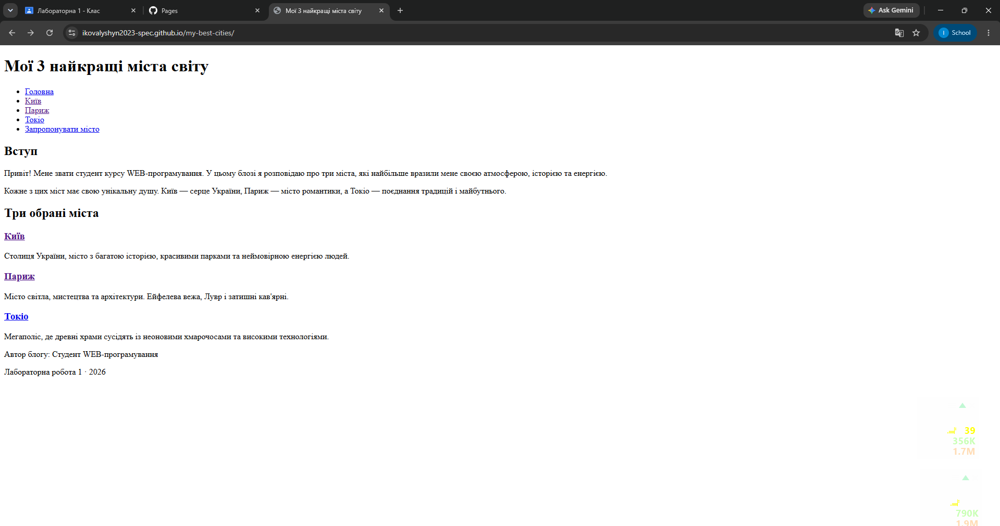

# Лабораторна робота №1
Імплементація блогу «Мої 3 найкращі міста світу»

## Мета
Створити багатосторінковий блог, розмістити на GitHub і опублікувати через GitHub Pages.

## Що реалізовано
- Головна сторінка, сторінки міст (Київ, Париж, Токіо), форма пропозиції
- Навігація, зображення, семантична розмітка
- Публікація на GitHub Pages

## Результат

## Висновок
Закріплено HTML-структуру сайту та деплой через GitHub Pages.
