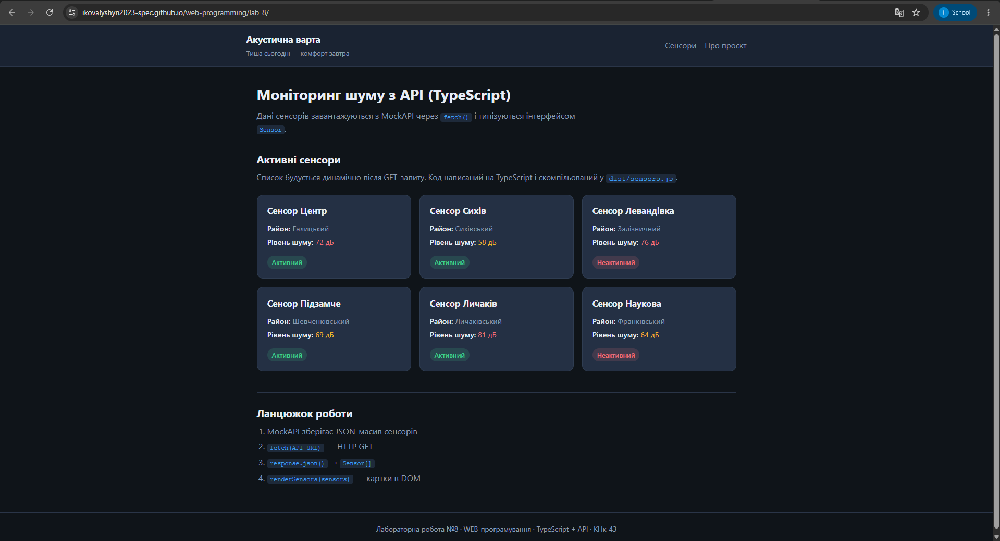

# Лабораторна робота №8

**Тема:** Робота з даними з API на TypeScript  
**Проєкт:** Акустична варта  
**Студент:** Ковалишин Іван Андрійович  
**Група:** КНк-43  

## Мета
Описати структуру даних з API через `interface`, завантажити сенсори за допомогою `fetch()` та `async/await`, відобразити типізований масив `Sensor[]` у вигляді карток на сторінці.

## Що реалізовано
- `interface Sensor` (id, name, district, noiseLevel, status)
- `loadSensors()` — HTTP GET до MockAPI
- `renderSensors(sensors: Sensor[])` — динамічні HTML-картки
- Компіляція TypeScript (`src/sensors.ts` → `dist/sensors.js`)
- Стилізація карток залежно від статусу та рівня шуму

## API
```
https://6ad1dd0466cd28aed82d00b8.mockapi.io/sensors
```

## Як зібрати
```bash
npm install
npx tsc
# відкрити index.html через Live Server
```

## Результат


## Висновок
Закріплено роботу з TypeScript: типізація відповіді API, async/await, безпечна робота з DOM через generics (`querySelector<HTMLDivElement>`).
